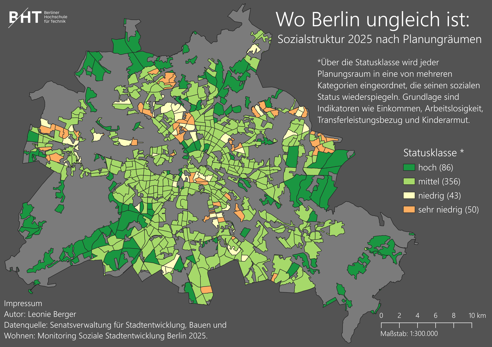
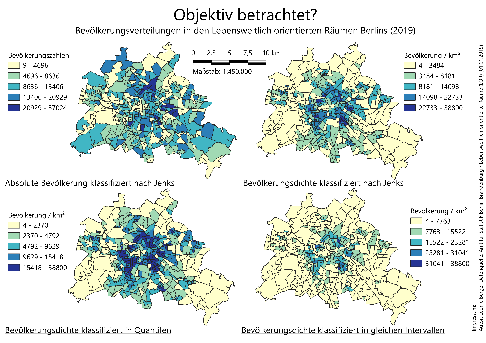

# EP 1
## Beispiel 1
Monitoring soziale Stadtentwicklung
Choroplethenkarten (Flächendichtekarten) stellen statistische Werte flächenbezogen dar und machen räumliche Unterschiede auf einen Blick sichtbar. Die abgestufte Farbgebung ermöglicht das erkennen und Vergleichen von Gebieten mit ähnlichen Eigenschaften. Hier zeigt die Karte, wie unterschiedlich die soziale Situation innerhalb Berlins verteilt ist.

Die Werte werden jeweils einer gesamten Fläche zugeordnet. Innerhalb eines Planungsraums können sich die sozialen Verhältnisse unterscheiden. Kleinräumige Unterschiede werden dadurch nicht sichtbar. Auch die Größe der Flächen hat Einfluss auf die visuelle Wirkung, das bedeutet: Große Planungsräume nehmen mehr Platz ein als kleine, obwohl sie nicht zwangsläufig mehr Einwohner umfassen.

# EP 02
## Beispiel 1
Lebensweltlich orientierte Räume

